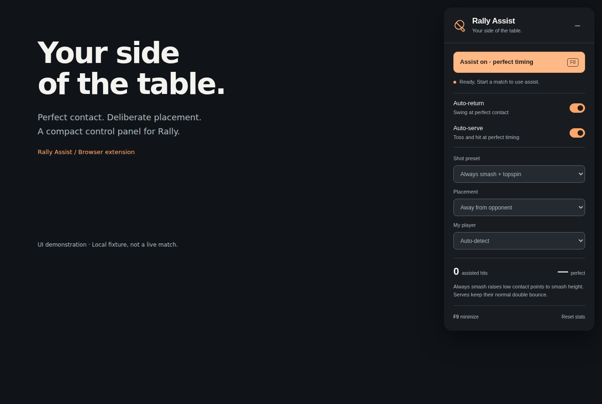
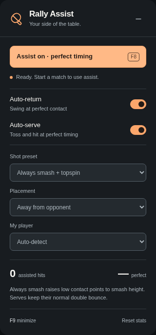
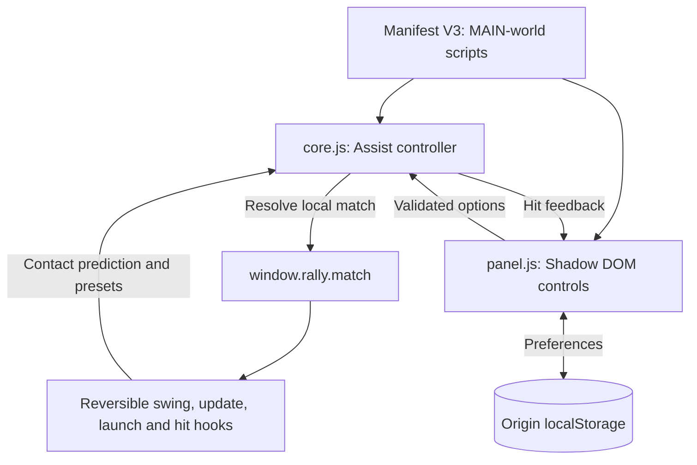

# Rally Assist

**A browser-side assist client for Rally: perfect contact timing, automated returns, and configurable shot placement.**

[Install](#install) · [Controls](#controls) · [Architecture](#architecture) · [Engineering notes](docs/architecture.md) · [Test evidence](docs/testing.md)



Rally turns a phone into a table-tennis paddle. Rally Assist is a separate Chrome / Edge extension that attaches to the display client and modifies the local player's swing timing and shot parameters. It reads the game's simulation directly through `window.rally`, rather than estimating ball position from screenshots.

Extension by **Bharat Bhati**, built for [Rally](https://playrally.cc), Aiden Guan's phone-controlled table-tennis game. [Original game source](https://github.com/aiden-guan/rally).

## What it does

| Control | Behavior |
| --- | --- |
| Perfect timing | Retimes eligible swings to the predicted contact instant, including manual swings. |
| Auto-return | Submits a swing as the game's update loop approaches a reachable return. |
| Auto-serve | Tosses and swings at the ideal serve instant, keeping the normal serve physics. |
| Shot presets | Smash, topspin loop, backspin chop, banana flick, power drive, or a rotating mix. |
| Placement | Aim away from the opponent, at center, or toward either corner in your player's frame. |
| Player selection | Detect the local side automatically, or select a human side in a shared-screen match. |
| Session feedback | Track assisted hits, perfect-contact percentage, and the last shot's kind and speed. |

The overlay uses Shadow DOM to isolate its styles, saves settings locally, and collapses to a small launcher. The extension contains no third-party runtime dependencies, background worker, account integration, or network requests of its own.

<p align="center">
  
  &nbsp;&nbsp;
  
</p>

Images show the real extension UI on a controlled fixture page. They do not depict a live match or demonstrate online performance. [Capture setup and reproduction](docs/media/README.md).

## Install

No build step or API key is required to use the extension.

1. [Download this repository](https://github.com/gothicscientist/rally-assist/archive/refs/heads/main.zip) and extract it, or clone it with Git.
2. Open `chrome://extensions` or `edge://extensions` on the computer displaying Rally.
3. Turn on **Developer mode**, choose **Load unpacked**, and select the repository folder containing `manifest.json`.
4. Open or refresh [playrally.cc](https://playrally.cc). The panel appears at the top right of the display page.
5. Enable assist and complete the normal lobby, pairing, and start prompts. Keep the phone paired when the game mode requires it.

Supported origins: `playrally.cc`, `www.playrally.cc`, the original `rally-gamma-gold.vercel.app` deployment, and HTTP `localhost` / `127.0.0.1`. The panel runs only at `/` and `/index.html`; phone, account, and stats routes are excluded by the panel's path check.

To update, replace the extension files, press **Reload** on the extensions page, and refresh Rally. To remove it, disable or remove the extension and refresh the game.

## Controls

| Input | Action |
| --- | --- |
| **F8** | Toggle assistance; disabling restores the wrapped game methods immediately. |
| **F9** | Minimize or reopen the panel. |
| **Auto-return off** | Swing manually while retaining perfect timing and the selected preset. |
| **Auto-serve off** | Toss and swing manually; timing assistance still applies. |
| **Reset stats** | Clear this page session's counters without changing saved preferences. |

Shortcuts ignore modifier combinations, repeats, and editable inputs. Minimizing preserves the current assist state. Preferences live in the Rally origin's `localStorage`; they are not synced between browsers or origins. Hit counters reset on refresh.

## Architecture



The core hooks into the existing game update loop while enabled. A separate 200 ms lifecycle poll finds new matches and refreshes the panel; it is not the contact-timing clock. On disable, match replacement, page exit, or an assist update error, the controller detaches its hooks.

### Decisions worth inspecting

| Problem | Approach | Tradeoff |
| --- | --- | --- |
| Timing through a low-frequency UI poll would miss fast contacts | Use the game's simulation time, predicted contact, and update loop. | Depends on internal game methods and prediction structures. |
| An isolated extension world cannot read the game's JavaScript objects | Declare `world: "MAIN"` and access the existing debug handle. | Page scripts share the execution environment; Shadow DOM isolates styling, not security. |
| Turning assist off must restore ordinary play | Store original method identities and restore only wrappers still owned by this instance. | Other modifications can still conflict with the same game internals. |
| The overlay must remain legible over the court | Compact opaque panel, clear active state, native select controls, and a collapsed launcher. | Small windows scroll inside the panel. |

[Read the module-level walkthrough, lifecycle, and timing model →](docs/architecture.md)

## Develop and verify

Runtime: plain JavaScript, Manifest V3, Shadow DOM, and browser storage. Development tools: **Node.js 22+**, npm, and Playwright Chromium.

```sh
git clone https://github.com/gothicscientist/rally-assist.git
cd rally-assist
npm ci
npm test
npx playwright install chromium
npm run test:ui
npm run screenshots
npm run check
```

`npm test` covers option validation, hook restoration, match replacement, local-side selection, lifecycle guards, hit accounting, and failure recovery. The browser suite loads the actual unpacked extension into Chromium against a controlled page. The [Actions workflow](.github/workflows/check.yml) runs these checks and uploads the captured UI images.

For a browser preview without installing the extension:

```sh
npm run preview
```

Open [http://127.0.0.1:4173](http://127.0.0.1:4173). This page loads the same UI and core scripts with explicit fixture-state controls; it does not run Rally. Stop with Ctrl+C.

The optional original-physics suite requires a compatible Rally source checkout. Its eight tests cover legal serves across frame rates, shot types, manual timing, shutdown, and match transitions. Game sources are not redistributed. [Setup and verification scope](docs/testing.md).

## Repository map

| Path | Responsibility |
| --- | --- |
| [manifest.json](manifest.json) | Supported origins, script order, and MAIN-world injection |
| [core.js](core.js) | Timing, presets, local-side selection, reversible hooks, and counters |
| [panel.js](panel.js) | Controls, Shadow DOM styling, shortcuts, persistence, and status |
| [tests/](tests/) | Core, installed-extension browser, and optional simulation checks |
| [scripts/](scripts/) | Validation, screenshot capture, and a local UI preview |
| [docs/architecture.md](docs/architecture.md) | Internal contracts, lifecycle, and implementation tradeoffs |
| [docs/media/](docs/media/) | Reproducible screenshots and capture notes |

## Compatibility and limits

This extension targets the Rally client interface examined on **October 22, 2026**. The original inspected `main.js` blob was `c0786faf7033351c019c8c6d373e9f104f6ee1d6`; this is a file identity, not a pinned repository commit. Updates to the live game can change compatibility even when the page still matches the manifest.

Assistance is restricted to a local, non-CPU paddle and respects pauses, replays, finished matches, and the start gate. Faults, lets, and edge balls are not turned into guaranteed returns. Smash mode raises low contact points to smash height; banana mode moves the contact point over the table. Those are deliberate client-side modifications, not just input automation.

The extension does not directly edit accounts, ratings, scores, or match results. Its modified swings can flow through the game's normal multiplayer logic. Real online-match behavior and the current production game require separate verification; fixture screenshots and physics tests do not establish either.

## Credits

Extension by **Bharat Bhati**. Underlying game: [Rally by Aiden Guan](https://github.com/aiden-guan/rally). The paddle mark is an original inline SVG; UI images are captured from this extension. Third-party game source and assets are not bundled. No project-wide reuse license has been selected.
