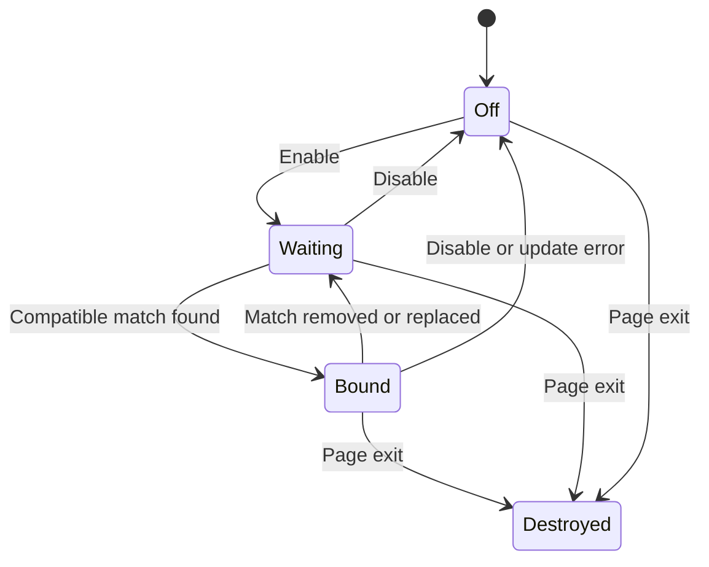

# How Rally Assist works

Rally Assist is a two-script extension running inside Rally's display page. There is no extension popup or server. [The manifest](../manifest.json) injects `core.js` first, then `panel.js`, at `document_idle` in the page's MAIN world.

## Modules and boundaries

| Module | Owns | Does not own |
| --- | --- | --- |
| `core.js` | Sanitized options, local player resolution, method wrappers, timing, presets, counters, and detachment | DOM, storage, game rendering, transport |
| `panel.js` | Shadow-root UI, settings, shortcuts, lifecycle poll, and accessible status | Shot physics and scorekeeping |
| `scripts/demo.js` | Explicit local fixture states for previewing the UI | Production injection; it is absent from the manifest |

`core.js` exposes `RallyAssistCore` on `globalThis`. Its `Assist` constructor receives a `getGame` function and an `onChange` callback, keeping the controller independently testable. The panel passes `() => window.rally` and its renderer.

## Lifecycle

1. Restore options from `rally.assist.v1`. Invalid JSON falls back to defaults; valid option objects pass through `sanitize`.
2. A 200 ms timer calls `sync` and refreshes the UI. While disabled or without a match, no game methods are wrapped.
3. `sync` checks the match's rally object for `swing`, `update`, `_launch`, `expectedWall`, and `hooks`, then records the original functions and installs its wrappers.
4. Each wrapped game update runs the assist tick before the original simulation update. Hit callbacks refresh session counters and forward to the original hook.
5. `detach` restores each method only if it still equals this instance's wrapper. This avoids overwriting a wrapper installed later by another tool.
6. On `pagehide`, the panel clears the interval, destroys the controller, removes its keyboard listener, and removes the overlay.

The interface check is shallow: it detects missing methods, not every internal schema change. Exceptions thrown by the assist tick disable assistance and detach the hooks before the original update runs. It is not a universal compatibility or exception boundary for all game callbacks.

## Contact timing

Rally already predicts an incoming ball's contact location and time. The controller uses that prediction rather than sampling rendered pixels.

| Situation | Target simulation instant |
| --- | --- |
| Serve toss | `segT0 + tossWin.ideal` |
| Eligible incoming flight | `segT0 + fate.contact.t` |

`tick` looks ahead by `max(0, dt) × pace × max(1, rate) + 0.025 × pace`. When contact falls within that window, it submits a swing using the existing simulation entry point. `perfectSwing` sets `sim` to the target minus a one-microsecond offset and derives `wall` using `expectedWall(at)`.

Manual eligible swings use the same timing path. Outgoing swings are not queued as future returns. Automatic serves retain the existing toss and serve model. The code never directly increments a score.

## Presets and placement

`preset` produces the game's existing swing parameter shape: power, lift, side, aim, and timing/read parameters. In mixed mode it rotates smash, topspin, banana, and chop using the assisted-hit count.

Automatic aim selects the opposite side from the opponent's body position, expressed in the local player's coordinate frame. Explicit left/right and center bypass that choice.

The `_launch` wrapper applies two additional modifications for ordinary shots:

- Smash raises contact height to at least `1.16`, above the inspected game's smash threshold.
- Banana caps the contact point's distance along the table to `1.25` and selects a backhand flick.

Those constants are tied to the inspected game version. [The optional simulation tests](../tests/simulation.test.mjs) verify resulting shot kinds and legal trajectories on the original snapshot; they are not proof of compatibility with later production versions.

## Player and match guards

Online `match.online.me` takes precedence over manual side selection. Local auto-detection chooses the first input of kind `phone` or `keyboard` whose player is local. `ours` further requires a local, non-CPU paddle.

The core skips automation during pauses, replays, finished matches, and incomplete start gates. Incoming returns also require legal, non-let, non-edge, unresolved flight predictions.

## UI and storage

An open shadow root isolates selectors and layout from Rally's CSS. The dark panel remains opaque for readability over the game. Switches retain native checkbox semantics, select fields retain native menus, and keyboard focus is visible. F8 toggles assist; F9 collapses the panel and moves focus to the corresponding visible control.

Saved options belong to the current site's `localStorage`. They contain no credentials. Storage failures are ignored so the current session remains usable. Counters live only in the controller instance and reset on reload.

The manifest requests no extension API permissions. Content-script origin matches still determine where the code can execute. MAIN-world execution shares the page's JavaScript environment; neither the shadow root nor the global core is a security boundary.

## Engineering tradeoffs

Direct simulation integration produces deterministic timing without a vision model or a second animation loop. It also creates tight coupling to undocumented internals. A game update can invalidate predictions, coordinate assumptions, or contact constants without changing the URL.

The smallest useful maintenance step is to verify the current game interface and rerun the physics suite against a compatible source checkout. A versioned adapter layer would be a reasonable future improvement if multiple game revisions must be supported; it is not implemented here.
